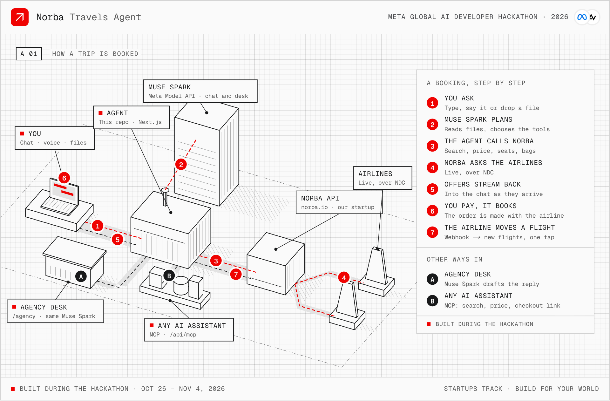

<p align="center">
  
</p>

<h1 align="center">Norba Travels Agent</h1>

> [!IMPORTANT]
> **Built during the hackathon.** Everything in this repository was written during the Meta Global AI Developer
> Hackathon's building period, from 30 October 2026 (the commit history starts there): the agent and its prompt,
> every tool, vision, voice, group trips, the guardian, checkout links, the agency desk, the MCP server and the
> terminal assistant, the mock, and the interface.
>
> | Already existed | How it is used |
> | --- | --- |
> | The Norba API | Norba is our own startup; its existing API (`api.norba.io`) is called over HTTPS |

A travel agent that works for you before, during and after the trip, built on **Meta's models** and booking real
flights through the **Norba API**, which talks to the airlines directly (NDC, New Distribution Capability).

- **From any message to a trip.** Type it, say it, or drop an invitation, a screenshot of a chat or a PDF: Muse Spark
  reads it and the agent searches, prices, seats, bags, travellers, card — to the booking reference.
- **Group trips from several cities.** One Muse Spark agent per traveller shortlists flights from their city; a
  coordinator thinking harder lands everyone together. Each traveller pays their own seat on their own link.
- **A guardian after booking.** When the airline moves a flight, its notice reaches the agent, which explains it and
  finds better flights; a photo of a departure board that says CANCELLED does the same. One tap switches.
- **An agency desk.** The same agent for a travel agency's staff, on Muse Spark Open: client requests read, options
  checked against the company's travel policy, the reply drafted; the agent at the desk approves.
- **The booking layer for any AI assistant.** An MCP (Model Context Protocol) server gives any assistant real airline
  search and checkout links, without ever handling a card.

Built for the Meta Global AI Developer Hackathon (Oct 26 – Nov 4, 2026), Startups track, theme *Build for Your
World*. [Norba](https://norba.io) is our own startup: a flight-distribution API that connects travel businesses to the
airlines through NDC. This agent is what we built on top of it during the hackathon.

## Meta's models in it

| Model | Where | What it does |
| --- | --- | --- |
| Muse Spark 1.3 (Meta Model API) | `/` chat | Plans the trip, calls the tools, writes every answer (streamed Chat Completions with tool calls) |
| Muse Spark 1.3 · reasoning high | group trips | The coordinator: one flight per traveller so the group lands together (structured output) |
| Muse Spark 1.3 · structured output | group trips | Each traveller's own agent shortlists their best three with a reason |
| Muse Spark 1.3 · vision | chat, agency desk | Reads invitations, screenshots, PDFs and departure boards into facts with boxes; turns a policy PDF into rules |
| Muse Spark Open (open weights, Baseten) | `/agency` | Reads client requests, checks options against the travel policy, drafts replies |
| Muse Voice Transcribe | chat | Dictation: the browser records, encodes WAV, the server transcribes |

## How it works

<picture>
  <source media="(prefers-color-scheme: dark)" srcset="docs/architecture-dark.png">
  
</picture>

- **A chat turn** is `POST /api/chat`, answered as NDJSON events; `GET /api/updates` brings later changes (a paid group
  seat, an airline notice) to the open conversation.
- **Norba API** calls: airports · offers/stream · calendar · offers/price · seats · services · quote · orders ·
  orders/{id} · reshop · change/confirm. Schedule changes come back on `order.schedule_changed`, to the conversation
  that booked the flight.
- **Any AI assistant** reaches `/api/mcp` for search, pricing and a checkout link, `/pay/<token>`, where the traveller
  books.

- **The model never sees raw offers.** A search returns 50–150 offers; the model gets a digest (itineraries grouped
  by flights, best-ranked first, each fare with a short ref like `o4`) while the browser receives every offer as it
  streams in, airline by airline. Follow-ups ("only non-stop") filter it locally, with no new airline request.
- **The model never sees a file.** Muse Spark reads each attachment once, into a fixed JSON shape with a box around
  every fact; the chat draws the boxes over the file, and the transcript keeps only the reading.
- **Personal data never reaches the model.** Travellers and card are filled in forms that post to this server only;
  the model reads a note (first names, "VISA ending 4242"). The card lives for the booking request and is wiped
  after it.
- **Only a person spends money or changes a booking.** The model opens the payment form but cannot book: the order is
  created when the traveller presses Pay, with one Idempotency-Key per attempt. A flight changes when they press
  Switch. Assistants on MCP and group travellers get checkout links and book on the page themselves.
- **The model's group plan is checked.** Refs must be the traveller's own; a plan that misses the arrival window gives
  way to the combination that lands the group closest together, and the chat says so.

### The twelve steps

| Phase | Steps |
| --- | --- |
| Plan | 01 Your request · 02 Airports · 03 Airline search |
| Choose | 04 Your flight · 05 Price check · 06 Seats |
| Prepare | 07 Bags & extras · 08 Travellers · 09 Review |
| Book | 10 Payment · 11 Booking · 12 E-tickets |

Every tool moves its step and the server streams the whole trip to the panel; the model also reads it on every turn.
A group trip moves the same panel: one request, a search per traveller, the plan, the holds, each payment.

### Agent tools

| Tool | What it does | Norba endpoint |
| --- | --- | --- |
| `ask_payment` | Card form with the reviewed total | — |
| `ask_traveller_details` | Traveller and contact form | — |
| `choose_extras` | Bags and extras the airline sells with the fare | `GET /v1/offers/{id}/services` |
| `choose_seats` | Seat map of every flight | `GET /v1/offers/{id}/seats` |
| `find_airports` | City / airport name → IATA (International Air Transport Association) or metro code | `GET /v1/aviation/airports?q=` |
| `find_rebooking` | Other flights for a booked, disrupted flight, each with a Switch button | `POST /v1/orders/{id}/reshop` |
| `list_airlines` | Airlines a search reaches | `GET /v1/network/airlines` |
| `plan_group_trip` | Agents per traveller and a coordinator for travellers from several cities | `POST /v1/shopping/offers/stream` |
| `price_calendar` | Cheapest fare per day, for flexible dates | `GET /v1/shopping/calendar` |
| `price_offer` | Confirm the chosen offer's price with the airline | `POST /v1/offers/price` |
| `refine_results` | Filter / re-sort the last search locally | — |
| `review_price` | The whole total, line by line | `POST /v1/offers/quote` |
| `search_flights` | One-way, round-trip or multi-city search, streamed | `POST /v1/shopping/offers/stream` |
| `skip_step` | Skip seats or extras | — |
| `suggest_replies` | Tappable answers under the message | — |

Buttons run what the model is not given: Pay runs `book_trip` (`POST /v1/orders`), Switch runs `change_flight`
(`POST /v1/orders/{id}/change/confirm`), Hold seats runs `hold_group` (a price check and a checkout link per traveller).

## Norba for any AI assistant (MCP)

`/api/mcp` speaks MCP over Streamable HTTP (JSON-RPC 2.0). Tools: `create_checkout`, `find_airports`, `get_order`,
`price_calendar`, `search_flights`. `create_checkout` prices the offer with the airline and returns a link; the
traveller enters names and card on that page. Set `MCP_TOKEN` to require `Authorization: Bearer <token>`.

```bash
# any MCP client: point it at http://localhost:3200/api/mcp — or try the terminal assistant on Muse Spark:
node scripts/any-assistant.mjs "Book me a non-stop from Madrid to Athens on 11 December"
```

## Run it

```bash
npm install
cp .env.example .env.local   # optional: everything but vision, voice and the desk works with it empty
npm run dev                  # http://localhost:3200 — the agency desk is at /agency
```

| `MODEL_API_KEY` | `NORBA_API_KEY` | What you get |
| --- | --- | --- |
| empty | empty | **Offline planner + mock flights.** Rule-based Spanish/English parsing drives the same tools through the whole booking; offers, seat maps, extras, orders, changes and disruptions are generated locally (card 4242 4242 4242 4242 books, 4000 0000 0000 0002 is declined). |
| set | empty | **Muse Spark on mock flights**: every Meta feature, nothing metered on Norba. |
| set | `nbr_test_…` | **The real thing on the airlines' sandboxes.** |

Every keyed Norba request is metered, so the mock is the default while building. In mock mode a booking card can
simulate the airline moving the flight, and `/board?c=<conversation>&status=CANCELLED` is a departure board showing
the booked flight cancelled, to photograph.

### The models

```bash
MODEL_API_KEY=…                      # Meta Model API
MODEL_BASE_URL=https://api.meta.ai/v1
MODEL_ID=muse-spark-1.3
MODEL_REASONING_EFFORT=low           # the chat; minimal | low | medium | high | xhigh | max, or empty
MODEL_PLANNER_EFFORT=high            # the group coordinator
OPEN_MODEL_API_KEY=…                 # Muse Spark Open for the agency desk (Baseten by default)
OPEN_MODEL_ID=meta-models/muse-spark-open-1026
```

The chat can run on Muse Spark Open too: point `MODEL_BASE_URL` and `MODEL_ID` at the partner, leave the effort empty
if it does not take one. Airline schedule changes arrive through `/api/webhooks/norba` with `NORBA_WEBHOOK_SECRET`.

## Deploy (Render)

`Dockerfile` builds the Next.js standalone server (Node 22, non-root, port from `PORT`); `render.yaml` is a Blueprint
for one Docker web service in Oregon (the Meta Model API refuses calls from an EU data centre) with `/api/status` as health check and manual deploys. Secrets are asked for
when the Blueprint is applied and never live in the repository or the image. Conversations, checkout links and limits
live in memory, so the service runs as a single instance.

```bash
docker build -t norba-travels-agent .
docker run -p 3300:10000 --env-file .env.local norba-travels-agent   # http://localhost:3300
```

A public demo spends money on every model call: `MAX_MODEL_CALLS_PER_DAY` caps the app and
`MAX_REQUESTS_PER_VISITOR_PER_HOUR` each visitor. With a `nbr_live_` Norba key real bookings stay off unless
`ALLOW_PRODUCTION_BOOKINGS=true`.

## Layout

```
src/
  app/api/chat         POST: one chat turn, form answer, attachment or notice, answered as NDJSON events
  app/api/mcp          MCP server for other assistants
  app/api/…            agency desk, checkout payment, transcription, updates poll, Norba webhook, mock simulations
  app/agency           the agency desk
  app/board            a departure board to film
  app/pay/[token]      checkout links
  server/agent         the loop (run.ts), tools (shopping, booking, servicing, group), vision, guardian, prompt, offline planner
  server/llm           Meta Model API client (Chat Completions, streaming, tools, structured output) and voice
  server/norba         Norba client: live (X-API-Key) and mock, behind one interface
  server/agency.ts · checkout.ts · mcp.ts
  components/chat      chat UI: trip panel, messages, cards, forms, vision, group plan, notices, rebooking
scripts/any-assistant.mjs   a terminal assistant on Muse Spark that books through Norba's MCP server
```

Conversations, checkouts and mock state live in server memory for a few hours; several instances would need a shared
store such as Redis.

## Design

Norba's brand: Cloud, Mist, Stone, Slate and Midnight with Vermilion for action, the Norba mark drawn in SVG, square
corners, hairline borders, mono uppercase eyebrows, 6 px square markers and the rising-fill buttons with the sliding
boxed arrow. Motion (messages rising in, the scan line while Muse Spark reads a file, boxes drawn on what it found, a
square crossing the flight line while airlines answer) honours `prefers-reduced-motion`. Light and dark themes.

## License

MIT — see [LICENSE](LICENSE). The Norba API this agent calls is a separate product and is not covered by it.
